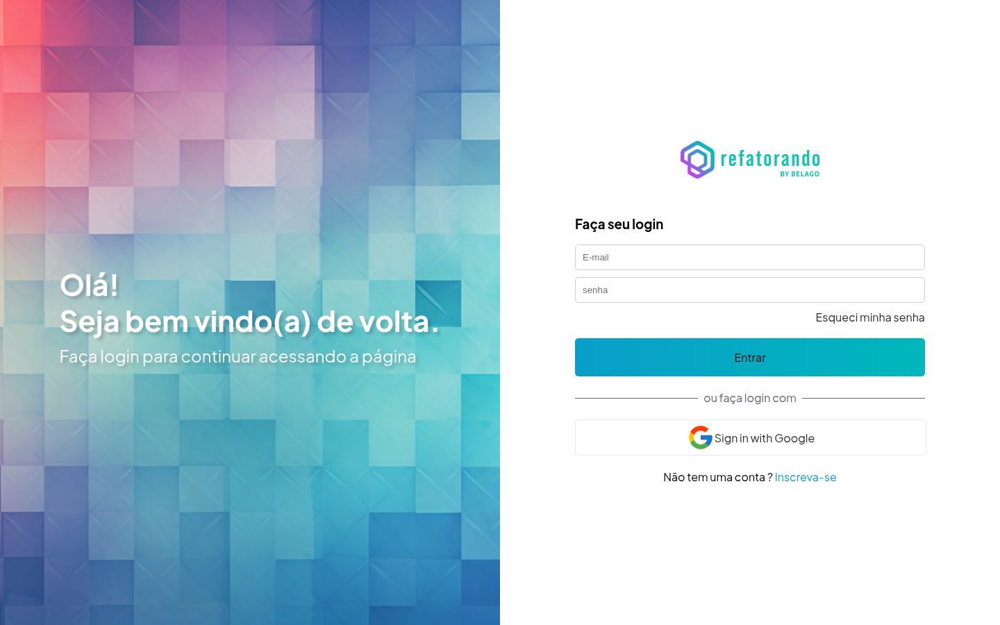

# Login Project



Tela de login responsiva criada como projeto do curso de desenvolvimento web da [Refatorando](https://refatorando.com.br/).

## Sobre o projeto

Este projeto foi desenvolvido durante minha formação como aluno da Refatorando, com foco nos fundamentos de HTML, CSS e responsividade. A tela pratica uma interface de autenticação dividida em duas áreas:

- painel visual com mensagem de boas-vindas;
- formulário de login com recuperação de senha, login social e cadastro.

## Responsividade

O layout usa um container com `100vw` e `100vh`, mantendo a tela limitada à viewport e sem scroll externo.

Em telas maiores, o container é dividido em duas colunas. Em telas menores, ele passa para uma coluna: o painel de boas-vindas ocupa a primeira parte e o formulário ocupa a maior parte restante.

## Animação do painel

O painel esquerdo utiliza `bg.png` como imagem de fundo. A animação é feita com `@keyframes`, alterando gradualmente o `background-position`:

- desktop: movimento horizontal alternado durante 90 segundos;
- mobile: movimento mais rápido, durante 5 segundos, também alternado.

O efeito usa `linear`, `infinite` e `alternate-reverse`, criando um deslocamento contínuo sem cortes bruscos.

## Tecnologias

- HTML5
- CSS3
- Flexbox
- Media queries
- Animações com `@keyframes`

## Como executar

Como o projeto é estático, basta abrir o `index.html` no navegador ou iniciar um servidor local:

```bash
python3 -m http.server 4173
```

Depois, acesse `http://localhost:4173`.

## Referências

- [Refatorando — Escola de Programação e Carreiras em Tecnologia](https://refatorando.com.br/)
